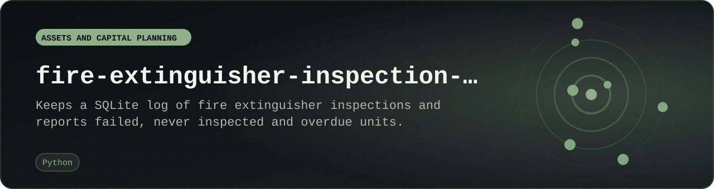
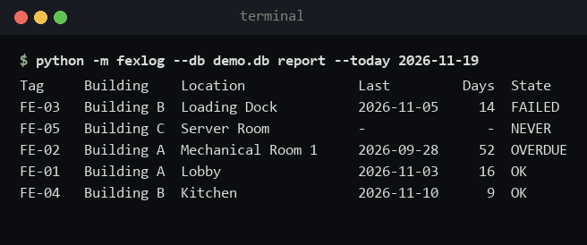

<p align="center"></p>

# fire-extinguisher-inspection-log

Keeps a SQLite log of fire extinguisher inspections and reports failed, never inspected and overdue units.



## What it is for

Fire codes call for a monthly visual check of every portable extinguisher, and a failed or missed check is a finding in any life safety audit. A safety officer, building manager or facility technician uses this tool to see which units need attention today. It keeps a small SQLite log of extinguishers and their inspections and reports which units are failed, never inspected, or overdue, worst first.

## Install

```
git clone <this repo> && cd fire-extinguisher-inspection-log
python -m pip install -e .
python -m pytest -q
```

## How to use

| I want to | Command |
| --- | --- |
| Load extinguishers and inspections from a CSV | `python -m fexlog --db demo.db load data/sample.csv` |
| Print the report as of a fixed day | `python -m fexlog --db demo.db report --today 2026-11-19` |
| Print the report as of today | `python -m fexlog --db demo.db report` |
| Hide units that are ok | `python -m fexlog --db demo.db report --problems` |
| Add an extinguisher | `python -m fexlog --db demo.db add FE-99 "Building Z" Lobby ABC` |
| Record a passed inspection | `python -m fexlog --db demo.db inspect FE-99 2026-11-10 --pass` |
| Record a failed inspection, with a note | `python -m fexlog --db demo.db inspect FE-99 2026-11-10 --note "Pin missing"` |
| See all options | `python -m fexlog --help` |

The database file defaults to `fexlog.db` when `--db` is left out.

Worked example:

```
python -m fexlog --db demo.db load data/sample.csv
python -m fexlog --db demo.db report --today 2026-11-19
```

Output:

```
loaded 10 rows
Tag     Building    Location              Last         Days  State
FE-03   Building B  Loading Dock          2026-11-05     14  FAILED
FE-05   Building C  Server Room           -               -  NEVER
FE-02   Building A  Mechanical Room 1     2026-09-28     52  OVERDUE
FE-01   Building A  Lobby                 2026-11-03     16  OK
FE-04   Building B  Kitchen               2026-11-10      9  OK
```

## How it works

- Two tables: extinguisher (tag, building, location, kind) and inspection (tag, date, passed, note).
- For each unit the latest inspection by date decides the state.
- FAILED if that inspection failed. NEVER if there is none. OVERDUE if more than 31 days have passed. Otherwise OK.
- The report sorts FAILED, NEVER, OVERDUE, OK, then by tag.
- Unknown tags, duplicate tags and bad dates are rejected with a message and exit code 1.

## Limits

- Covers the monthly visual check only. Annual maintenance and six-year or twelve-year hydrostatic tests are not tracked.
- The 31-day interval is fixed in code, not read from a local fire code.
- A failed unit stays FAILED until a later passing inspection is recorded. Replacement or recharge is not modeled.
- The sample data is invented.

## License

MIT. Yassine Emhamed, 2026.
